# PrintTender

A local-first maintenance tracker for 3D printers. Runs as a **native macOS desktop
app** and an **Android app** from a single Flutter codebase. All data lives in a
SQLite database on the device — no account, no server, fully offline.

## Download

[](https://github.com/frankt2012/PrintTender/releases/latest)

Installers are attached to the [latest release](https://github.com/frankt2012/PrintTender/releases/latest):

| Platform | File | Requirements |
|---|---|---|
| macOS | `PrintTender-<version>.dmg` | macOS 12 or later, Apple Silicon or Intel |
| Android | `PrintTender-<version>.apk` | Android 7.0 or later, arm64-v8a / armeabi-v7a / x86_64 |

### macOS: the first launch needs one extra step

The app is not notarized — there is no Apple Developer ID behind it — so macOS
quarantines anything downloaded and refuses to open it the first time. Either:

1. Open the DMG, drag **PrintTender** onto **Applications**, then **right-click the
   app in Finder and choose Open**, and confirm with **Open**. Once is enough;
   after that it launches normally.
2. Or clear the quarantine flag from Terminal, then open it as usual:

```bash
xattr -dr com.apple.quarantine /Applications/PrintTender.app
```

Only a paid Apple Developer account, with Developer ID signing plus notarization,
makes the app install without that step.

### Android: allow the install

The APK is signed with its own release key rather than the public Android debug key,
so later versions install over it as updates. Android still asks you to allow
installing from unknown apps the first time, and Play Protect may flag an app it
does not recognise.

## What it does

- **Printer inventory** — name, manufacturer, model, serial number, purchase date,
  notes, a running total print-hours odometer, and the nozzle and build plate it is
  set up with.
- **Maintenance library** — 58 reusable task definitions (nozzle, belts, lead
  screws, linear rods, carbon rods, fans, PTFE tube, wiring, lubes, filters,
  resin-specific jobs, …) in nine categories, seeded on first run and fully
  editable. The eight essentials are ticked as defaults.
- **Per-printer schedules** — assign any library task to a printer and give it a
  trigger of *every N print hours*, *every N months*, or both.
- **Reminders** — every schedule is graded **OK → Due soon (85% consumed) →
  Overdue**, and the dashboard surfaces everything that needs attention across the
  whole workshop, most urgent first. A local notification summarises the same list
  every morning, and stays silent when nothing is due.
- **Maintenance log** — record what you did, when, at what print-hour reading, what
  parts you used, what it cost, and any notes. Completing a scheduled task resets
  its timer automatically.
- **History & costs** — per-printer history plus a running total of parts spend.
- **Backup** — export the whole database to a JSON file through the system share
  sheet (Save to Files, Drive, email, …) and restore it from a file picker.
- **A Mac app rather than a phone app stretched** — on macOS the dashboard is a
  source list of printers beside a content well, the menus are in the menu bar
  with keyboard shortcuts, the add/edit/picker flows are sheets, and the window
  has a unified title bar. See [The macOS app](#the-macos-app).
- **Year board** — a calendar grid of the year's maintenance, on the desktop
  targets only, showing what was logged when and what the schedules have coming.

## Screenshots

Taken in both appearances, with a demo workshop rather than real data. The desktop
build restyles Material to look like AppKit; on a phone it keeps the stock Material
look.

| Dark | Light |
|---|---|
| 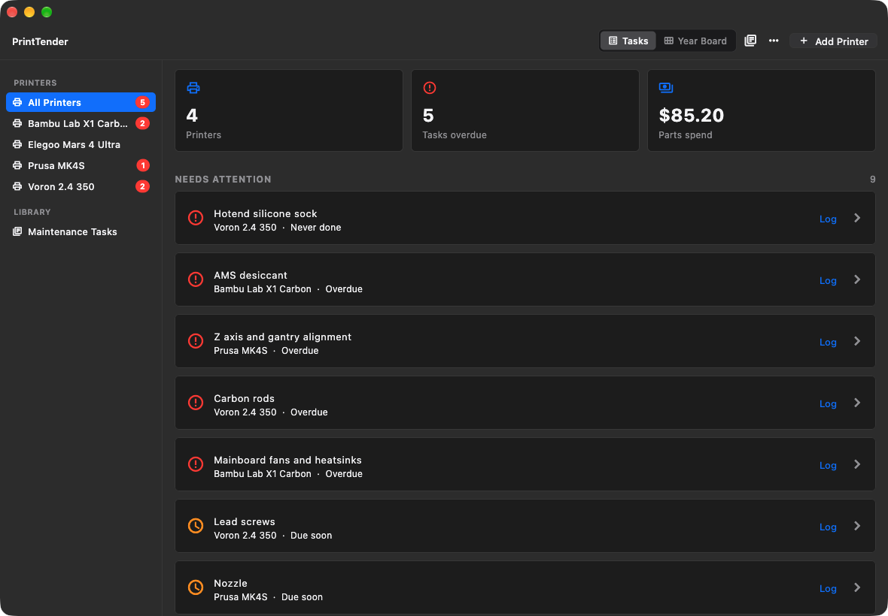 | 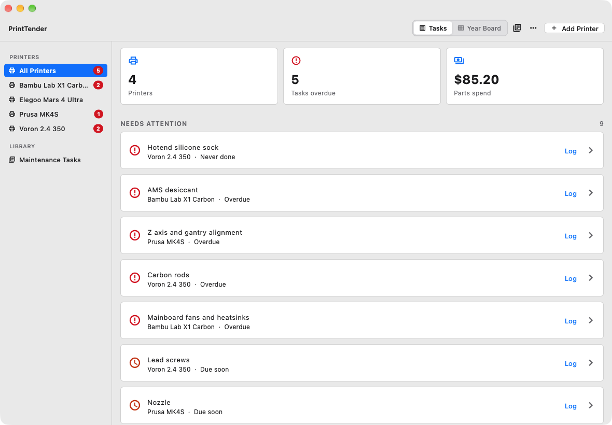 |
| 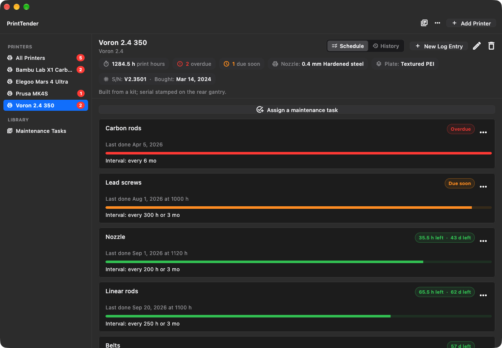 | 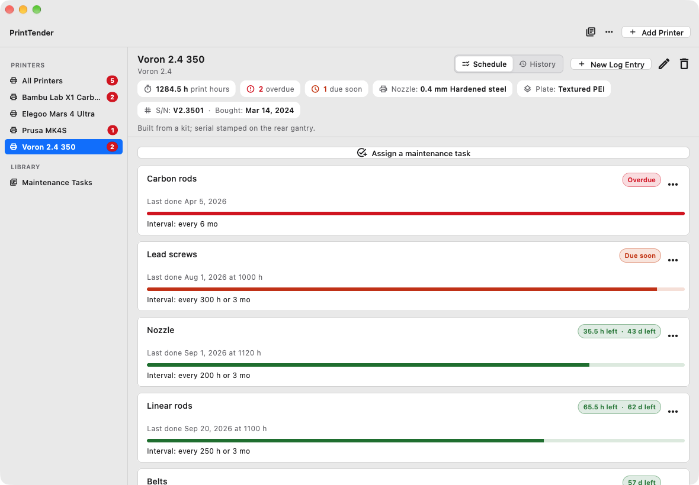 |
| 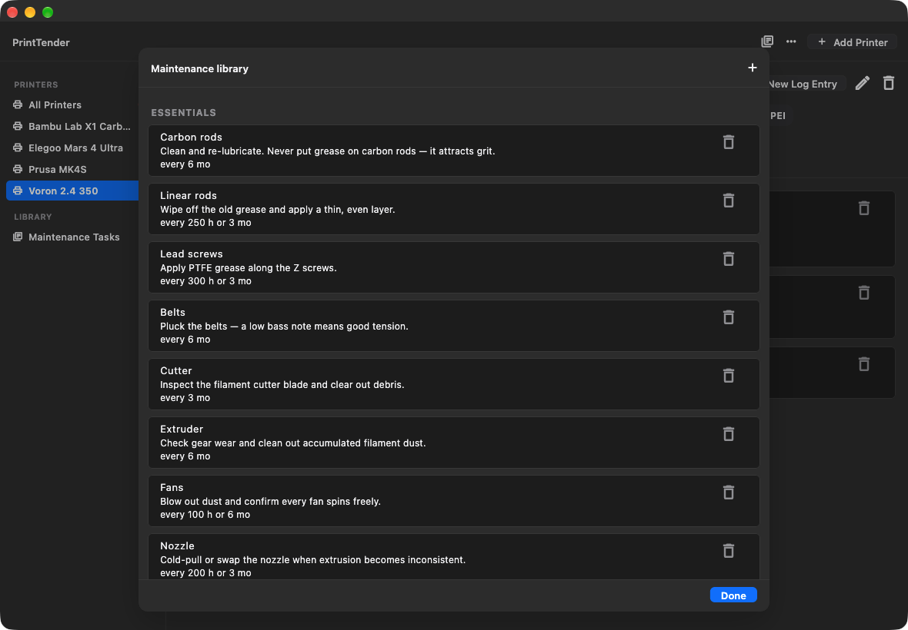 | 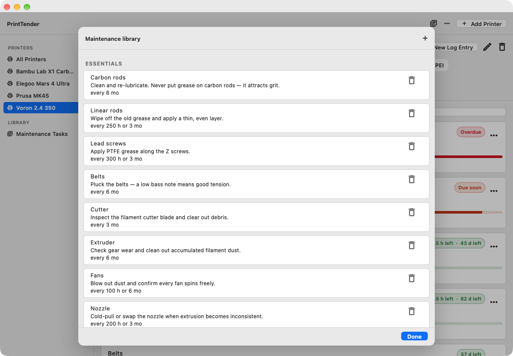 |

History keeps what each job cost, per printer:

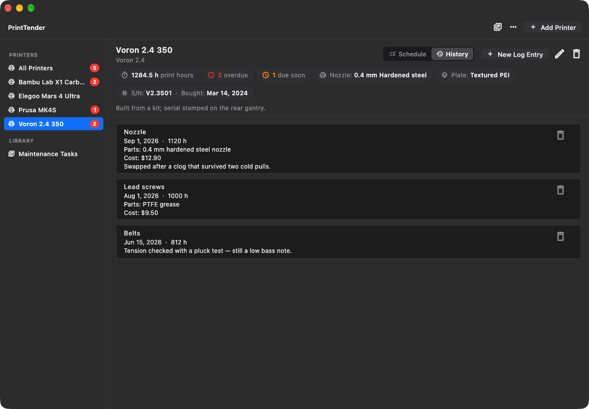

Logging a job, from a printer's pane or straight off the dashboard:

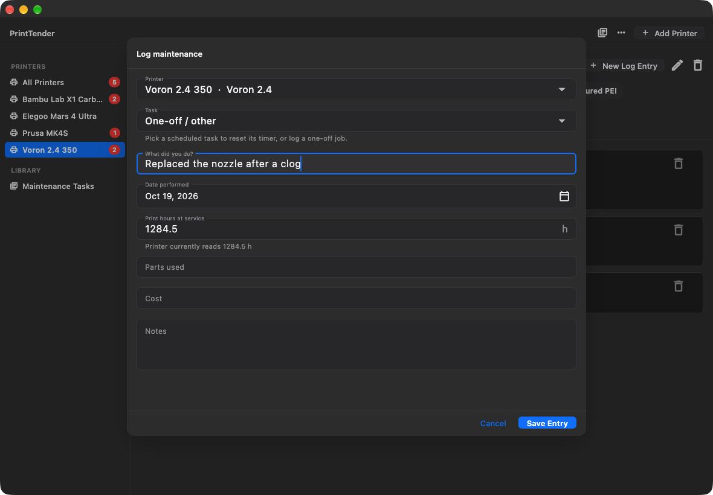

The year board, desktop only:

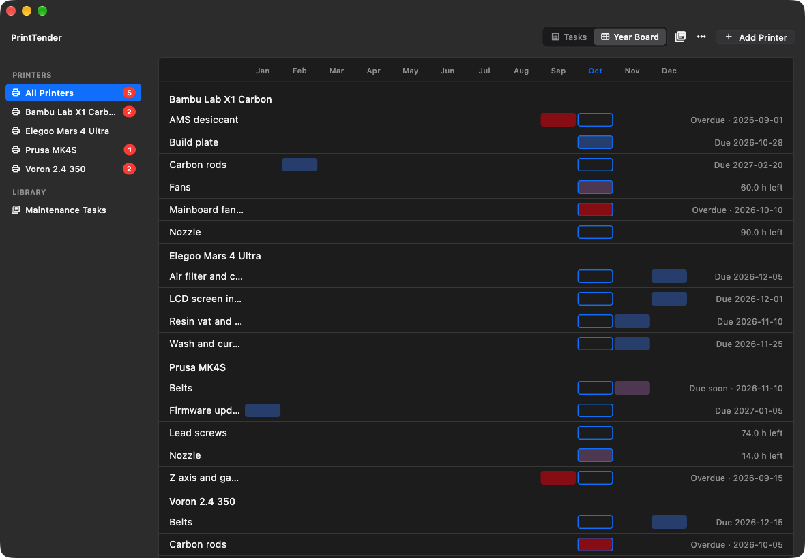

The same workshop on a phone:

| Dark | Light |
|---|---|
| 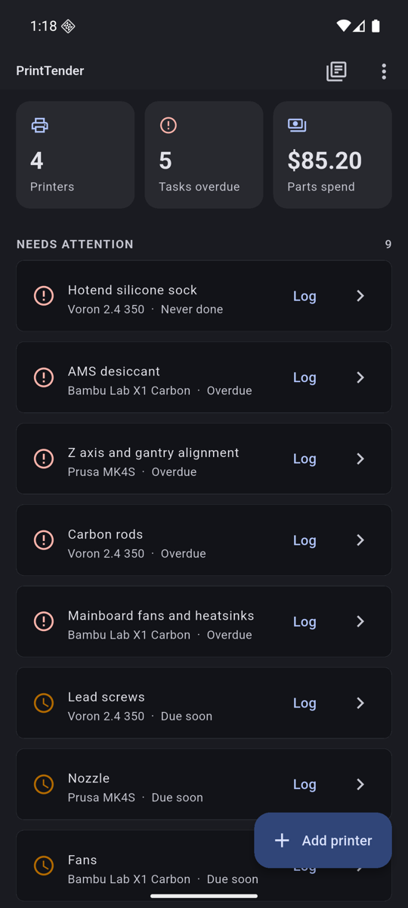 | 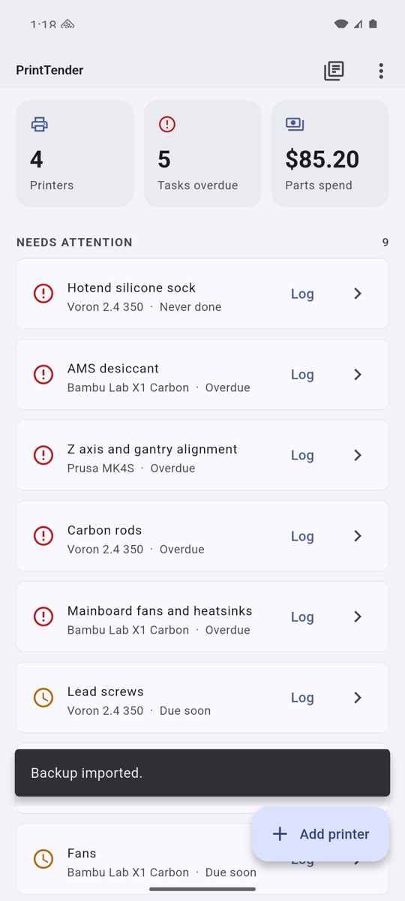 |

## Requirements

Any recent Flutter 3.x will do; these are the versions this was built and
tested against, and the paths they live at here.

| Tool | Version | Location |
|---|---|---|
| Flutter | 3.47.7 | `/opt/homebrew/share/flutter` |
| Dart | 3.13.5 | bundled with Flutter |
| OpenJDK | 21.0.12.1 | `/opt/homebrew/opt/openjdk@21` |
| Android SDK | platform 36, build-tools 36.0.0 | `/opt/homebrew/share/android-commandlinetools` |
| CocoaPods | 1.17.0 | `/opt/homebrew/bin/pod` |

`flutter doctor` reports the Android toolchain as fully green. The macOS desktop
target additionally needs **full Xcode** (the Command Line Tools alone are not
enough) — see below.

## Running

The Android toolchain needs `JAVA_HOME` and the SDK path exported:

```bash
export JAVA_HOME=/opt/homebrew/opt/openjdk@21
export ANDROID_HOME=/opt/homebrew/share/android-commandlinetools
export ANDROID_SDK_ROOT=$ANDROID_HOME
export PATH="$JAVA_HOME/bin:$PATH"
```

### Android

```bash
flutter devices                 # find your phone / emulator id
flutter run -d <device-id>      # debug run on a connected device
flutter build apk --release     # build an installable APK
```

The APK lands at `build/app/outputs/flutter-apk/app-release.apk`. Copy it to the
phone and install (enable "install unknown apps" for the file manager).

#### Signing

Release APKs are signed with a private keystore that is deliberately kept out of
this repository. Gradle reads `android/key.properties` (git-ignored) for its path
and passwords, and falls back to the debug key when that file is missing, so a
fresh clone still builds. On a new machine:

```bash
keytool -genkeypair -v -keystore ~/keystores/printtender-release.jks \
  -storetype JKS -alias printtender -keyalg RSA -keysize 2048 -validity 10000 \
  -dname "CN=Your Name, O=PrintTender, C=US"
```

```properties
# android/key.properties — never committed
storePassword=…
keyPassword=…
keyAlias=printtender
storeFile=/Users/you/keystores/printtender-release.jks
```

Back the keystore up somewhere safe. Without it you cannot sign an update that
installs over copies already out there — Android refuses an upgrade whose signature
changed. Continuous integration reads the same values from the
`ANDROID_KEYSTORE_BASE64`, `ANDROID_KEYSTORE_PASSWORD`, `ANDROID_KEY_ALIAS` and
`ANDROID_KEY_PASSWORD` repository secrets.

### macOS desktop

Requires full Xcode installed and selected:

```bash
sudo xcode-select --switch /Applications/Xcode.app/Contents/Developer
sudo xcodebuild -runFirstLaunch

flutter run -d macos
flutter build macos --release
```

The built app appears under `build/macos/Build/Products/Release/PrintTender.app`.

#### Universal builds, and a second Mac

Release builds are universal: `lipo -archs Contents/MacOS/PrintTender` reports
`x86_64 arm64`, and every Mach-O in the bundle carries both. The same `.app`
therefore runs on Apple Silicon and Intel Macs alike, requiring only macOS 12
(`LSMinimumSystemVersion` = 12.0).

Flutter controls this with `enable-macos-arm64-only`, false today but documented
as flipping to true in a future release before Intel support is discontinued. It
is pinned explicitly on this machine so an upgrade cannot silently drop it:

```bash
flutter config --no-enable-macos-arm64-only
```

Transferring the app to a second Mac trips Gatekeeper. There is no Developer ID
identity here — the only codesigning identity on this machine is a self-signed
certificate named `PrintTender Local Signer` — so AirDrop, Mail or a browser
download stamps on `com.apple.quarantine` and macOS refuses to open it. Locally
built it carries no quarantine and opens normally. To run it elsewhere:

```bash
# simplest: right-click the app in Finder and choose Open, once
xattr -dr com.apple.quarantine /Applications/PrintTender.app   # or strip it wholesale
```

#### Why the built app is re-signed

`flutter build macos --release` signs the bundle ad-hoc, and an ad-hoc signature
is regenerated on every build. macOS keys code-identity state to the signature —
the notification permission, and access to protected files inside the sandbox
container — so a rebuild would leave the app looking like a different app, back
at a fresh notification prompt. Builds here are therefore re-signed with the
self-signed identity, which does not change between builds: nested frameworks
first, then the app with its Release entitlements, and no injected
`get-task-allow`:

```bash
id="PrintTender Local Signer"
app=/Applications/PrintTender.app

for fw in "$app"/Contents/Frameworks/*.framework; do
  codesign --force --timestamp=none --sign "$id" "$fw"
done

codesign --force --timestamp=none --sign "$id" \
  --entitlements macos/Runner/Release.entitlements "$app"

codesign --verify --deep --strict "$app"   # -> valid on disk
```

To do the same on another Mac, create a self-signed certificate of type **Code
Signing** in Keychain Access → Certificate Assistant, then use its name. It only
grants a stable local identity; it is trusted nowhere else. Without an Apple
Developer membership there is no Developer ID signing and no notarization, which
is the expected state of a personal app.

## Releases

Pushing a tag publishes installers. The [release workflow](.github/workflows/release.yml)
builds the signed APK on Linux and the DMG on a macOS runner, then attaches both to a
GitHub Release named after the tag. Versions in the file names come from `pubspec.yaml`,
so bump `version:` before tagging:

```bash
git tag v1.0.1 && git push origin v1.0.1
```

Running the workflow by hand (Actions → Release → Run workflow) builds the same two
artifacts without publishing anything, which is a way to test the pipeline. The DMG it
produces is signed ad-hoc; the re-signing described above is a per-machine convenience.

To do it locally instead:

```bash
flutter build apk --release

mkdir -p /tmp/stage
ditto build/macos/Build/Products/Release/PrintTender.app /tmp/stage/PrintTender.app
ln -s /Applications /tmp/stage/Applications
hdiutil create -volname PrintTender -srcfolder /tmp/stage -ov -format UDZO \
  PrintTender-1.0.1.dmg

gh release create v1.0.1 --title "PrintTender 1.0.1" PrintTender-1.0.1.dmg \
  build/app/outputs/flutter-apk/app-release.apk
```

## Tests

```bash
flutter analyze     # static analysis, currently clean
flutter test        # 75 tests, all passing
```

Coverage:

- `test/due_status_test.dart` — the OK / due-soon / overdue decision logic, including
  calendar-vs-hour triggers, the months maths (end-of-month clamping, leap years,
  and month spans of 91–92 days), disabled tasks, and never-performed tasks.
- `test/database_test.dart` — runs the real SQLite schema end to end: library
  seeding, printer setup fields, months round-trips, joins, cascade deletes, cost
  totals, archive filtering, and clearing optional fields.
- `test/migration_test.dart` — builds a version-1 database by hand and opens it with
  the current code, proving the upgrade renames the original seeds in place (keeping
  their schedules) and then tops the library up to the full set.
- `test/backup_test.dart` — snapshot / encode / decode / restore, including
  replacing a non-empty database, refusing foreign files, and rejecting documents
  from a newer format version.
- `test/app_flow_test.dart` — drives the actual UI at phone dimensions through
  adding a printer, assigning a task, seeing it flagged, and logging maintenance
  from the dashboard to clear it. Also covers the nozzle/build-plate setup fields,
  starting a printer with the eight essentials already scheduled, hiding the
  print-hours field on calendar-scheduled tasks, the dashboard odometer action, the
  prefilled reading on an hour-scheduled task, and export writing a real backup.
- `test/reminder_test.dart` — the morning digest: no notification at all when
  nothing needs attention, how an overdue / due-soon / never-done schedule reads as
  a line of text, the cap that turns a long list into a count, and the equality
  that lets an unchanged list skip being rescheduled.
- `test/macos_ui_test.dart` — the desktop-only shell: the theme is built around the
  system font and accent, `pushPage` lays a page out as a floating sheet rather than
  a full screen, the sheet button bar cancels, saves and refuses both while busy,
  and the sidebar highlights exactly one row.
- `test/macos_pane_test.dart` — the embedded printer pane: its header costs a
  fraction of the height of the screen it replaced (152px against 318px), the
  schedule and history panes switch, every reading fits on one bar, and nothing
  overflows at the narrowest window the app allows.
- `test/appearance_test.dart` — measures WCAG contrast against the built themes in
  both appearances. The status colours, the error colour, the untouched badge and
  the chip fills all stay legible in light mode, while dark mode keeps the exact
  values it was designed with.

The widget tests point the app at an in-memory database via two test hooks on
`AppDatabase` (`factoryOverride`, `pathOverride`). File-backed SQLite never
resolves under the fake async clock that widget tests run on, so an in-memory
database is the only way to exercise the real data layer inside a widget test.

### On-device tests

`integration_test/app_test.dart` runs the same journey against a genuinely
installed app, so it exercises the real `sqflite` and `path_provider` plugins
rather than test doubles:

```bash
flutter test integration_test/app_test.dart -d <device-id>
```

It covers the empty state, the full add → schedule → log → clear journey, the
prefilled odometer reading, and a backup snapshot round-tripping through the real
on-device database.

Note that the log-entry form is a lazy `ListView`. On a phone the on-screen
keyboard shrinks the viewport, so the save button scrolls below the cache extent
and is not built until it is scrolled into view — the test therefore calls
`scrollUntilVisible` before tapping it.

## Project layout

```
lib/
  main.dart                       app entry + theme
  data/
    models.dart                   Printer, MaintenanceTask, PrinterTask, LogEntry
    task_library.dart             the 58-entry starter library + presets
    database.dart                 SQLite schema + migrations, desktop FFI bootstrap
    repositories.dart             CRUD for printers, tasks, schedules, log
  services/
    due_status.dart               OK / due-soon / overdue evaluation
    backup.dart                   snapshot / encode / decode / restore
    backup_io.dart                save panel (export) and file picker (import)
    notifications.dart            the morning "needs attention" digest
  ui/
    macos_theme.dart              AppKit-flavoured theme, platform helpers
    mac_sidebar.dart              the desktop source list of printers
    mac_controls.dart             segmented control, sheet button bar
    routes.dart                   pushPage: a sheet on desktop, a page elsewhere
    widgets.dart                  shared badges, progress bars, stat cards
    screens/
      dashboard_screen.dart       fleet overview, attention list, backup, digest
      printer_detail_screen.dart  per-printer schedule + history, embedded on desktop
      edit_printer_screen.dart    add / edit a printer
      add_log_entry_screen.dart   record maintenance
      task_definitions_screen.dart maintenance library CRUD
docs/
  screenshots/                    the images used in this README
assets/
  icon/
    PrintTender Round.png    Android artwork as supplied, 1024×1024
    PrintTender Square.png   macOS artwork as supplied, 1024×1024
    printtender-round.png    Round with real alpha — what the generator reads
    printtender-square.png   Square with real alpha — what the generator reads
    printtender-icon.png     superseded first attempt, no longer referenced
    printtender-icon-source.jpg  that attempt's original artwork, kept as-is
tool/
  icon_probe.swift          derives adaptive-icon settings from a source image
  restore_alpha.swift       recovers transparency lost to a JPEG export
  alpha_grid.swift          renders an alpha channel as a 16×16 text grid
```

## Naming and icons

The user-visible name is **PrintTender**. Three related identifiers deliberately
do *not* follow it:

- **Dart package name** — still `printer_maintenance`, so none of the ~40 imports
  across `lib/` and `test/` need touching. Invisible to users.
- **Android applicationId** — still `com.franktriolo.printer_maintenance`, and the
  macOS bundle id is still `com.franktriolo.printerMaintenance`. Changing either
  would make the OS treat a new build as a different app, discarding the installed
  database on the phone.
- **Backup file marker** — an exported snapshot carries `"app": "printer_maintenance"`.
  That is how the importer recognises its own files; changing it would make every
  backup already exported fail validation.

Launcher icons are generated, never hand-edited. Two images feed the generator —
Round for Android, Square for macOS — and each has to carry real alpha first:

```sh
swift tool/restore_alpha.swift "assets/icon/PrintTender Round.png" assets/icon/printtender-round.png
swift tool/restore_alpha.swift "assets/icon/PrintTender Square.png" assets/icon/printtender-square.png
dart run flutter_launcher_icons
```

`restore_alpha` exists because JPEG cannot store transparency: exporting a
transparent image to JPEG flattens it and renders that transparency as a visible
checkerboard, which is exactly what both supplied files contained. Used as-is
they would have shipped an icon with a checkerboard border. The script keys it
back out — a pixel is a candidate only if it is neutral grey *and* bright,
matching the two checkerboard tones, and candidates are then flood-filled from
the image border so tinted artwork inside the design is never reached however
pale it gets. It prints the coverage it recovered; `tool/alpha_grid.swift`
dumps the result as a 16×16 opacity grid so the shape can be checked before
trusting it.

`dart run flutter_launcher_icons` then produces the five Android densities twice
over (the legacy `mipmap` bitmap for pre-8.0 launchers and the
`mipmap-anydpi-v26` adaptive icon) plus the full macOS `AppIcon.appiconset`.

Two adaptive-icon settings are worth understanding:

- **`adaptive_icon_foreground_inset: 16`** — how large the roundel reads. Android
  guarantees only a 66dp circle at the centre of the 108dp canvas stays visible,
  but the real mask is a squircle wider than that: the earlier square badge sat at
  68.3dp and was clipped only *slightly* at the corners, where a strict 66dp
  circular mask would have taken ~15dp off them. A circle inscribed at a
  squircle's full width is tangent along the axes and clears its rounded corners
  entirely, so a roundel can sit at that width and stay circular. The roundel is
  93% of its square, so 16% puts it at 68.4dp and 18% at 64.4dp. Lower the value
  to grow the roundel, raise it to shrink it — but keep it at or below the mask
  width, past which the mask's own shape takes over and the icon stops looking
  round.
- **`adaptive_icon_background: "#FFFFFF"`** — an opaque layer, which the adaptive
  format requires. It shows through the roundel's transparent margin as a thin
  white halo wherever the launcher's mask reaches past the artwork.

To re-derive both values from a new source image rather than inheriting them:

```sh
swift tool/icon_probe.swift assets/icon/printtender-round.png
```

It reports opaque coverage, the extent and centring of the design, and the
smallest inset that keeps it inside the 66dp safe zone. Given an image *without*
alpha it instead reports the edge colour and how flat it is, which is what
decides whether a flat adaptive background will sit seamlessly behind it.

## How the due-date maths works

For each scheduled task the app computes how far through each configured interval
you are:

```
hours_progress = (printer.total_print_hours - schedule.last_done_hours) / interval_hours
months_progress = (today - schedule.last_done_at) / months_to_days(interval_months)

progress = max(hours_progress, months_progress)
```

Whichever limit you reach first wins, so a task with both an hour and a month
interval comes due on the earlier of the two. `progress >= 1.0` is **overdue**,
`>= 0.85` is **due soon**, otherwise **OK**. A task that has never been performed
counts as overdue immediately. Setting the hour interval to 0 or leaving every
interval blank marks the task as *unscheduled*.

Month intervals are calendar-correct rather than a fixed 30 days: three months from
15 March spans 92 days, and adding a month to 31 January clamps to 28 February (29
in a leap year). The interval is described in the UI as, for example,
`every 200 h or 3 mo`.

## Print hours

`printer.total_print_hours` is the odometer — the total print time the machine
itself reports. It is the *only* thing hour-based intervals are measured against,
so a task scheduled purely by hours will never come due until that number grows.
Tasks scheduled by months are unaffected. Two things move it:

- the speed-dial button on a printer row on the dashboard, and
- logging a maintenance entry with a **higher** reading than the stored one, which
  carries the odometer forward automatically (a reading that is *lower* is recorded
  on the log entry but leaves the printer total alone, so a typo cannot rewind it).

The log-entry form adapts to the task being logged:

- **Calendar-scheduled task** (e.g. *Build plate*, every 3 months) — the print-hours
  field is hidden and a note explains why, because the reading is irrelevant.
  Logging still resets the clock.
- **Hour-scheduled task** (e.g. *Nozzle*, every 200 h or 3 mo) — the field is shown
  and **prefilled with the printer's current reading**, so the common case is
  accepting it.
- **One-off job** — the field is shown so you can record where the odometer stood.

New printers offer a *Start with the eight essentials* checkbox (on by default)
which installs the eight core tasks and marks them as serviced today, so a
freshly-added machine does not open with a wall of overdue alarms. Tasks you assign
by hand still count as never done, and therefore overdue, until you log them once.

## The macOS app

The desktop build is styled to look native rather than like a phone app in a window.
The widgets are still Material, restyled: a unified title bar with the traffic lights
inset into a 28px strip, `.AppleSystemUIFont` throughout, and the system accent
colour supplying the blue.

- **A source list, not a drawer.** Printers live in a sidebar, badged when they need
  attention; picking one opens its schedules and history in the pane beside it
  without leaving the window.
- **Menus in the menu bar**, with the shortcuts you would expect: ⌘N add printer,
  ⌘L maintenance library, ⌘E export, ⌘I import, ⌘1 schedule, ⌘2 history.
- **Sheets for the modal flows** — add/edit printer, log entry, maintenance library —
  dropping in over the window instead of replacing it.
- **A compact pane header.** The printer header is a single 152px bar carrying the
  name, serial and purchase date, nozzle and plate, the schedule/history switch and
  the actions. Both panes keep their scroll position when you switch.
- **A window that remembers itself** — opens at 1180×820, never smaller than
  900×620, and restores its own frame between launches.
- **Light and dark, both designed.** Dark uses Apple's system red, amber and green
  unchanged; light uses darker variants of the same hues, worth 5.3:1 or better on
  white, because the system colours land near 2.2:1 there and are hard to read.
- **Year board**, desktop only: the year as a grid of days, showing what was logged
  and what the schedules have coming.

A true native-controls port (AppKit widgets rather than restyled Material ones) was
considered and deliberately not attempted: it would have meant rewriting every screen
and putting the Android look at risk. The restyle buys most of the feel for far less
scope.

## Notifications

Reminders are local and scheduled on the device — no server, and the app stays
entirely offline.

An hour-based task has no date to alarm on: the odometer only moves when a
reading is logged, so "every 200 h" cannot be predicted ahead of time. Rather
than only covering the calendar intervals, the app sends one **morning digest**
at **09:00 local time**, listing everything the schedules currently say is
overdue or due soon:

```
2 tasks need attention
Nozzle on Voron 2.4 is overdue
Build plate on Prusa MK4 is due soon
```

- **Only when there is something to report.** If the workshop is healthy, the
  scheduled notification is cancelled, so there is nothing to swipe away and no
  daily nag.
- **Refreshed on every dashboard load** — at launch, after every edit and on
  pull-to-refresh — because the text has to be written into the alarm when it is
  scheduled. The worst case is a digest that is one app session behind.
- **Asked for permission once**, on the first launch where a schedule exists,
  and never re-asked after that. Switching reminders back off afterwards is done
  in system settings (the Android 13+ runtime permission, or macOS notification
  settings).
- **Inexact alarms on purpose.** `inexactAllowWhileIdle` is the kind of alarm
  Android still grants without the restricted `SCHEDULE_EXACT_ALARM` permission,
  and a reminder does not need the second it fires in.
- **Survives a reboot** through the plugin's boot receiver (`RECEIVE_BOOT_COMPLETED`
  in the manifest), and is re-registered every time the app opens.
- **Both platforms.** The same code path schedules the digest on Android and on
  macOS, where it has been verified end to end from a clean install.

## Notes

- **Desktop SQLite:** the `sqflite` plugin is mobile-only, so on macOS the app
  initialises `sqflite_common_ffi` and drives the OS SQLite library directly.
- **Storage location:** on macOS the database lives inside the sandbox container at
  `~/Library/Containers/com.franktriolo.printerMaintenance/Data/Library/Application Support/…`;
  on Android it lives in the app's private data directory.
- **Schema upgrades:** the schema is versioned and upgraded in place on open. Going
  from a v1 database renames the original eight seeded tasks (so any schedules
  already attached to them keep working) and then inserts whatever the full library
  adds. A task you had deleted comes back as a fresh, unscheduled entry.
- **Backups export, they do not sync.** The file is a plain JSON snapshot with row
  ids preserved, so foreign keys survive a restore. Importing *replaces everything*
  on the device after a confirmation prompt.
- **Notifications are best-effort.** Nothing runs in the background when a
  notification fires, so the digest carries whatever the last dashboard load
  computed. A task that comes due while the app is closed is reported the next
  time the app opens, and a failure to schedule is logged rather than shown — it
  must never turn a working dashboard into an error screen.
- **Backups on desktop** go through an ordinary save panel, so the file lands where
  you choose. There is no save panel on Android, so the export goes out through the
  system share sheet instead ("Save to Files", Drive, email, …).
- **No sync.** Each device keeps its own database by design. Point both at a shared
  cloud database later if you want them in step.
- The maintenance library and the months-based intervals were inspired by
  [frankt2012/3d-printer-maintenance-log](https://github.com/frankt2012/3d-printer-maintenance-log)
  (MIT licensed).

## Possible next steps

- Attach photos to log entries (`image_picker` + macOS entitlements).
- Spare-parts inventory with stock levels and reorder thresholds.
- Import print sessions from slicer history to advance the odometer automatically.
- Cloud sync (Supabase or similar).

## How this was built

Most of the code, tests and documentation here was written by an AI coding
assistant at **frankt2012**'s direction, with human decisions on design and scope,
and human verification of the test suite, release builds and shipped installers.
There has been no independent code review or security audit. Treat it accordingly.

## Licence

[MIT](LICENSE) © 2026 Frank Triolo.
